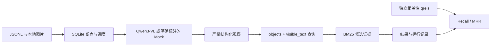

# VisionEvidence-Agent

VisionEvidence-Agent 是一个基于视觉语言模型（VLM）和文本检索的实验项目，主要研究一个问题：**将图像内容转换为结构化文本，能否改善相关文本的检索效果？**

项目使用 Qwen3-VL-4B-Instruct 从图像中提取对象、动作及其他视觉属性，并将这些信息构造成检索查询，通过 BM25 从候选文本中检索相关描述。实验基于 Flickr8k 数据集，比较原始描述与结构化视觉信息在检索任务中的表现。

目前已完成本地 VLM 推理、检索评测、批量实验和独立测试集验证。

## 实验结果

在 Flickr8k 的独立测试集上，选取 100 张未参与当前开发集策略选择的图像，比较原始描述基线与结构化查询策略（`format_details`）。

| 方法 | Hit@10 |
|---|---:|
| Baseline | 0.780 |
| Structured (`format_details`) | 0.720 |

结构化方法相较基线下降 6 个百分点，配对差异的 95% CI 为 [-0.170, 0.050]。在当前实验设置下，**没有观察到结构化策略相较基线的稳定检索优势**。

项目保留了完整的实验配置、失败记录与结果审计信息，便于后续复现和分析。评测**。

研究问题：将图像的可见对象和文字组织成结构化观察，能否比完整自然语言描述构造更好的证据检索查询？如何保留失败、来源、标注边界和计算成本，使比较可审核？

当前覆盖视觉观察 → 查询构造 → BM25 候选证据 → 可恢复批量评测。**最终事实核验决策、Agent 规划、Dense/Hybrid Retrieval 尚未实现。** 候选证据与模型描述均不是已确认事实，模型输出始终 verified=false。

## 流程与状态



- 真实 Qwen3-VL-4B：单 GPU BF16、本地权重、首次加载复用、耗时/显存记录；已有单图实测。
- 严格观察解析：拒绝截断/散文，保留失败原响应；不自动补造字段。
- BM25：保留文档 ID、来源、原文、分数；独立 qrels 驱动端到端 Recall@K/MRR@K。
- T05-A：流式 JSONL、稳定 ID、分批调度、SQLite 进度、断点、重试、成功缓存、输入/源码/模型哈希、Commit/环境追踪。
- CPU/Mock 可本地运行；真实实验与合成接口验收分别记录。
- VERITE 适配器已用官方 CSV 小子集验证；真实图片受机构邮箱申请及条款限制。[数据选择](docs/t05_datasets.md)。
- Flickr8k V1.0 真实 GPU：20 张独立图片、40 次 Qwen 调用、5,000 条候选描述；Baseline Hit@10=0.65、Structured=0.35，后者有五条失败，当前没有检索提升。[GPU 审计报告](docs/flickr8k_real_gpu_3ec02ca_report.md)。
- V1.1-A：格式约束与视觉信息保留独立开关、严格失败拒绝、全 attempts 导出和离线 dev/test 队列已实现。[历史实现与实验方案](docs/v11a_implementation_and_protocol.md)。
- V1.1 正式冻结：五路真实 dev 各 20 图，按预定规则选定 format_details，dev Hit@10=0.90（Baseline=0.80）。[冻结记录](docs/v11_freeze_and_independent_test.md) 保留当时的准备状态与协议。
- **V1.1 独立测试已封存**：原 test 第 21–120 图，两路共 200 次已审计真实 VLM 调用。Baseline Hit@10=0.780，format_details=0.720，差值 95% 配对 CI=[−0.170, 0.050]；MRR@10 分别为 0.516579、0.516679。结构化分支 94/100 成功，六次 ValueError 全计零，原始状态保留 incomplete。**开发集优势未在独立测试中稳定复现，不能表述为显著提升，也不能据区间跨零宣称等效。** [正式审计报告](docs/v11_independent100_audit.md)、[封存索引](experiments/v11/independent100-sealed-20261027/seal-index.json)。
- V2.0 目前只有 [研究方案](docs/v20_research_plan.md)：固定查询比较 BM25、Dense、Hybrid；尚未实现或运行新实验。

## 已有实验与边界

三种规模始终分开：**证据库文档数、评测查询数、真实 VLM 图片推理调用数**。独立图片另计，重试不是新图片。

| 实验 | 证据文档 | 查询/样本 | 真实图片推理调用 | 结论 |
| --- | ---: | ---: | ---: | --- |
| T03-B-5 GPU smoke | 0 | 0 个检索查询，1 张输入图 | 6 次，独立图 1 张 | RTX 4090D 加载复用成功；6/6 达 token 上限，观察质量未通过验收 |
| T04-4 合成对照 | 12 | 10，9 条进入指标分母 | 0 | Structured 无一致优势 |
| T04-5 人工辅助审核 | 12 | 同一 10 个场景 | 0 | 120 个样本-文档关系，非 120 个查询或图片 |
| T05 CPU/Mock 分阶段 | 5 | 100 → 1,000 → 10,000 | 0 | 验证调度/缓存/恢复；复用 1 个合成白像素 fixture，不代表万张真实图片 |
| VERITE 元数据子集 | 0 | 12 条配对记录 | 0 | 8 图片路径、本地图片 0，非检索效果实验 |
| Flickr8k 真实 JPEG + Mock | 5,000 条候选描述 | 20 图片查询/路，共 40 查询槽位 | 0 | 20 张真实图已解码；本行 Mock 不提供视觉质量指标 |
| Flickr8k V1.0 GPU | 5,000 条候选描述 | 20 图片查询/路，40 槽位 | 40 次，独立图 20 张 | Structured 15/20 成功，Hit@10=0.35，弱于 Baseline 0.65；失败计零 |
| V1.1-A 合成 CPU/Mock | 10 条合成描述 | 合成 dev 两图，四种配对消融及续跑 | 0 | 验证接口、严格拒绝、缓存和来源，不代表检索改善 |
| V1.1 五路真实 dev | 5,000 条候选描述/路 | 20 图片查询/路，100 槽位 | 100 次，独立图 20 张 | format_details 20/20 成功，Hit@10=0.90；只用于策略选择，早期另有4次重叠图片 Smoke 单独归档 |
| V1.1 独立 test | 5,000 条候选描述/路 | 100 图片查询/路，200 槽位 | 200 次，独立图 100 张 | format_details Hit@10=0.72，Baseline=0.78；六条失败计零，未获得提升证据 |

T04 固定合成集主结果（宏平均 n=9，非空 qrels 的查询失败记零）：

| 方法 | Recall@1 | Recall@3 | Recall@5 | MRR@5 |
| --- | ---: | ---: | ---: | ---: |
| 完整描述 Baseline | 0.555556 | 0.777778 | 0.777778 | 0.722222 |
| Structured | 0.611111 | 0.666667 | 0.666667 | 0.666667 |

场景、描述、结构字段和证据由 AI 合成；人工在 AI 辅助阅读后确认 120 个关系：相关 11、不相关 109，与冻结标签一致。这不是盲审或标注者间一致性。全部指标差异来自 S08 空提取和 S10 首位改善；ASCII 分词、同义/否定处理不足及闭集合成偏差仍存在。[协议](docs/t04_4_protocol.md)、[报告](docs/t04_4_report.md)、[失败审计](docs/t04_5_report.md)、[后续人工审核](docs/t04_5_human_archive.md)。

历史 GPU 首次加载约 4.78 秒；256-token 复用 wall 均值约 6.44 秒，512-token 约 12.97 秒；PyTorch allocated 峰值约 8,751 MiB，整卡采样最大 9,241 MiB。口径不同，不能保证新图片/并发容量；没有视觉或最终核验准确率。[单图 GPU 报告](docs/t03_b5_report.md)。

## Windows 本地运行

要求已有项目 `.venv`、Python 3.12；无需激活，不使用全局 Python。没有环境时先由开发者确认创建方案。运行基础设施无第三方依赖；pytest/Pillow 是开发依赖，Qwen 使用独立 Linux GPU 环境。

```powershell
.\.venv\Scripts\python.exe -m pip install -e ".[dev]"
.\.venv\Scripts\python.exe -m pip check
.\.venv\Scripts\python.exe -m visionevidence.cli --version
.\.venv\Scripts\python.exe -m pytest
```

若 Git 报 dubious ownership，可仅对当前 PowerShell 进程配置项目例外后测试，不改全局设置：

```powershell
$env:GIT_CONFIG_COUNT='1'
$env:GIT_CONFIG_KEY_0='safe.directory'
$env:GIT_CONFIG_VALUE_0='D:/Research/VisionEvidence-Agent'
.\.venv\Scripts\python.exe -m pytest
```

## CPU/Mock：100 → 1000 → 10000

以下是合成调度验收，不分析真实图片。先准备完整输入，保持文件不变；新实验使用新目录，--resume 扩大前缀并跳过成功样本。

```powershell
.\.venv\Scripts\python.exe scripts/prepare_t05_mock.py --output outputs/t05-input-new.jsonl --count 10000
.\.venv\Scripts\python.exe -m visionevidence.batch --mode mock --samples outputs/t05-input-new.jsonl --corpus examples/evidence_demo.jsonl --output outputs/t05-run-new --limit 100 --batch-size 32
.\.venv\Scripts\python.exe -m visionevidence.batch --mode mock --samples outputs/t05-input-new.jsonl --corpus examples/evidence_demo.jsonl --output outputs/t05-run-new --limit 1000 --batch-size 128 --resume
.\.venv\Scripts\python.exe -m visionevidence.batch --mode mock --samples outputs/t05-input-new.jsonl --corpus examples/evidence_demo.jsonl --output outputs/t05-run-new --limit 10000 --batch-size 512 --resume
```

输出含固定 manifest、输入快照、state.sqlite3、每阶段独立 summary/results，以及包含失败/原响应的 attempts JSONL。--max-attempts 默认 2，是跨 session 累计预算，修复缺图后可显式提高，成功结果不覆盖；V1.1 受控实验显式设为 1。退出码 0=所选样本完成，1=有未完成样本，2=配置/输入/目录错误。

prompt、源码、证据库、配置或模型改变要新目录；成功图片哈希变化拒绝缓存。batch-size 是调度大小，GPU 逐图推理。[输入/qrels/恢复协议与 GPU 小批命令](docs/t05_pipeline.md)、[本轮验收](docs/t05_report.md)。

## 真实数据与后续研究

Flickr8k 用于 **image-to-caption retrieval proxy**。此前 20 张 test 图仅作诊断；V1.1 另选 100 张独立 test 图，现已完成并封存。正确 caption 只用于候选库与相关性 qrels，不进入 VLM prompt 或图像生成查询。qrels 显式标记 caption_pair_proxy。封存时相关 CPU 测试 **89 passed**；历史全量测试数量见对应版本的验收记录。

```powershell
.\.venv\Scripts\python.exe -m visionevidence.caption_experiment --dataset data/processed/flickr8k-proxy-v1/test --output outputs/flickr8k-mock-new --mode mock --limit 20
```

上面的 Mock 命令仅作历史诊断；[V1.0 runbook](docs/flickr8k_runbook.md) 保留历史复现方式。V1.1 在 dev 前二十图选择策略，冻结后评测 test 第 21–120 图，各自候选库为原 split 的 5,000 条描述。已暴露的 V1.1 dev/test 不再用于 V2.0 新确认结论；V2.0 新划分与未来预算须在执行前单独冻结。指标不能称为谣言识别准确率；相似图描述可能相关，五条同图描述也不是独立图片样本。

按 [VERITE 元数据步骤](docs/t05_datasets.md) 接入，再经 [官方 HF](https://huggingface.co/datasets/stefpapad/VERITE) 申请图片；保留图片哈希与条款。当前官方 CSV 和论文总数差 1 条，适配器按实际字节原样保留。

VERITE 图文配对真假标签不能直接作为检索 qrels；Flickr8k 同图 caption 可构成明确标记的关联代理 qrels，不能据此评价真实事实核验。外部证据检索需要独立相关性标注，最终核验还需要事实标签与证据出处。

历史 GPU 命令保留作复现资料。V1.1 原件只读封存；本次封存不新增 GPU 或模型调用。未来 V2.0 实现、权重获取和新实验须分别进入后续任务与预算审批，万级 GPU、真实检索标注及最终 verifier 仍待研究。

## 历史复现与导航

```powershell
.\.venv\Scripts\python.exe -m visionevidence.evaluation.observation --dataset data/evaluation/t04_v1 --config configs/t04_evaluation.toml --output outputs/t04-replay-new
.\.venv\Scripts\python.exe scripts/validate_t04_human_review.py
.\.venv\Scripts\python.exe -m visionevidence.cli retrieve --query "flood road closures" --corpus examples/evidence_demo.jsonl --top-k 3 --json
```

| 路径 | 用途 |
| --- | --- |
| src/visionevidence/batch.py | 批量 CLI、SQLite、来源、评测 |
| src/visionevidence/datasets/verite.py | 官方 CSV 适配与标签隔离 |
| src/visionevidence/datasets/flickr8k.py | 固定版本小图下载、离线导入、原始划分和五描述 |
| src/visionevidence/caption_experiment.py | Baseline/Structured 同候选对照与 proxy 指标 |
| src/visionevidence/description.py | 原始散文 VLM 描述直接检索基线 |
| src/visionevidence/vlm/ | Mock/Qwen、本地加载与契约 |
| src/visionevidence/observation.py | 严格解析、查询来源、观察到检索 |
| src/visionevidence/retrieval/ | BM25 与语料校验 |
| configs/ | 模型/检索配置、观察 Schema |
| experiments/ | 小型审计归档，不放图片/大数据 |
| docs/qwen3_vl_deployment.md | 人工部署与 GPU 环境要求 |

实验输出独占新目录，不覆盖旧结果。Commit 经开发者授权，push 由开发者手动执行。
